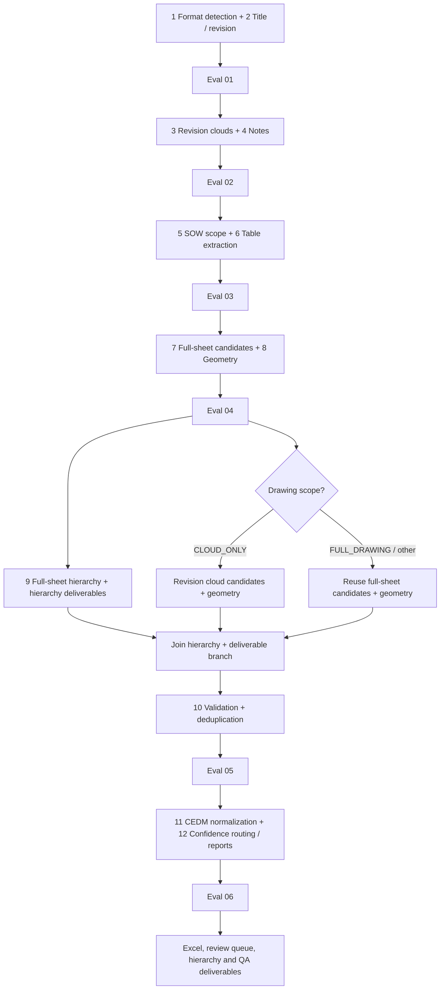

# Orchestration map

The LangGraph DAG uses six eval gates and preserves the original extraction scripts as subprocess nodes. Logical pipeline steps are grouped into paired quality gates to keep validation deterministic and low-cost.

The full-sheet hierarchy branch always consumes preserved step5a_candidates_full.json and step5b_associations_full.json. For drawings marked CLOUD_ONLY, a separate deliverable branch overwrites only the non-full candidate/association artifacts. Both branches must complete before validation and final normalization.

## Paired eval gates

| Gate | Coverage | Checks |
|---|---|---|
| 01 | Format + title | Required context artifacts and valid JSON |
| 02 | Clouds + notes | Cloud regions and notes context artifacts |
| 03 | SOW + tables | Scope-memory and table context artifacts |
| 04 | Full-sheet candidates + geometry | Full-sheet artifacts, valid JSON, candidate bbox shape |
| 05 | Hierarchy + validation + dedup | Hierarchy graph, validation and dedup outputs |
| 06 | CEDM + confidence routing | CEDM output, final workbook, review queue |

These evals are deterministic artifact/contract checks and make zero additional model calls. They are smoke tests, not a substitute for precision/recall against labelled ground truth.

## Model routing

Defaults live in api/model_routing.py. Each Gemini stage reads its task-specific CDCI_MODEL_* environment override. Current defaults use Flash-class models for classification, title, notes, scope and tables, and Pro-class models for cloud localization and candidate extraction. Deterministic OpenCV, geometry, hierarchy construction, validation, deduplication, normalization and confidence routing do not invoke an LLM.

## Observability and reliability

Events in events.jsonl capture job ID, stage start/finish/failure, elapsed seconds, exit status, attempt count, chosen model route and eval outcome. Full subprocess stdout/stderr are written to logs/pipeline.log. API keys are redacted from command telemetry. The LangGraph SQLite checkpointer persists completed node states; transient provider rate-limit/unavailable errors receive one bounded retry. Existing Gemini wrappers also handle per-call retries where used.

Token/cost counts are not reported because the legacy scripts do not expose consistent usage metadata. Add provider usage extraction at each Gemini call before publishing token or cost dashboards.

## Retrieval strategy

No vector RAG is added. Annexure-2 scope rules and Annexure-4 registers are structured Excel data; notes and table extraction are drawing-specific structured JSON. Deterministic lookup is simpler, reproducible and cheaper than embeddings for these bounded inputs. Introduce vector/hybrid retrieval only when the system searches a large multi-project engineering knowledge corpus.

## Demo boundary vs production deployment

The recruiter demo uses local disk, SQLite, one active job by default and FastAPI background execution. This is intentionally a single-process demo, not a claim of production scale.

Before production traffic, add:
- PostgreSQL job state and a PostgreSQL LangGraph checkpointer; durable Redis/SQS queue and isolated worker pool.
- S3-compatible object storage with lifecycle policy and signed, tenant-scoped download URLs.
- Authentication/authorization, tenant isolation, request quotas, malware/content validation and secret-manager integration.
- Distributed model/API rate limits, idempotency keys, retention policy and dead-letter handling.
- OpenTelemetry traces/metrics, alerting, structured audit events, and provider token/cost usage collection.
- Integration/e2e test fixtures, labelled precision/recall benchmarks, and human-review feedback loops.

These are explicit production gates; SQLite/local storage is kept for the local demonstration because it avoids requiring external infrastructure to run the repo.
